

  

  
  
  
  
  
  

## About me

I keep cloud infrastructure running: the monitoring that catches a problem before a user does, the least-privilege access path that removes the bastion host, the runbook that lets someone else fix it at 3 a.m. Seven years across AWS and GCP, most recently at enterprise scale in regulated gaming.

**Currently looking for** Cloud Operations, SRE, DevOps, or Platform Engineering roles, and open to consulting and freelance work in the same areas. If you're hiring, the fastest way to judge my work is the repositories below. They're the real thing, not tutorials.

- **Las Vegas, NV** · open to remote and hybrid
- **Nevada gaming license** holder
- **Studying for the CKA** (Certified Kubernetes Administrator)
- **Writing** on [dev.to](https://dev.to/rafagross) and [AWS Builder Center](https://builder.aws.com/community/@rafagross)

## Background

At **International Game Technology** I operated AWS infrastructure for gaming platforms serving millions of end users — EC2 and EKS fleets, CloudWatch observability, IAM boundaries, patching and backup under audit requirements. Regulated gaming means change control is real: nothing ships without a rollback path and a record of who approved it.

Before that, three years as a **Pre-Sales Cloud Engineer at CODESA**, a Google Cloud partner, architecting solutions for enterprise clients across Latin America — which is where I learned to explain an architecture to the people paying for it, not just the people building it.

## Certifications

  <a href="https://www.credly.com/badges/0bf12c58-0a81-4c5e-820e-98bb1f3ed66a">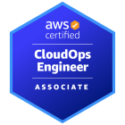</a>
  
  
  <a href="https://www.credly.com/badges/75e8ce56-a1c0-48dc-99e6-da357fe9df0e">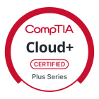</a>
  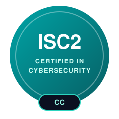
  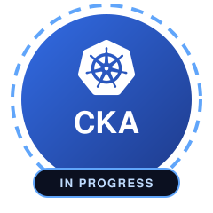

<a href="https://www.credly.com/users/rafa-gross"><b>Verify on Credly →</b></a>

## Selected work

  <a href="https://github.com/Rafagross/fraud-detection-aws-platform"></a>
  <a href="https://github.com/Rafagross/eks-prometheus-grafana-runbook"></a>
  <a href="https://github.com/Rafagross/container-runtime-runbooks-homelabs"></a>
  <a href="https://rafael-gross.com"></a>

## Tech stack

  
  
  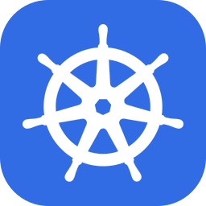
  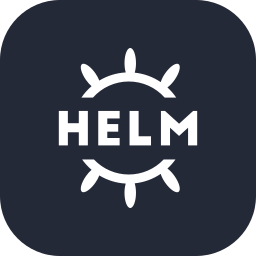
  
  
  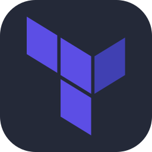
  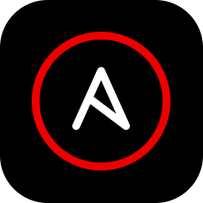
  
  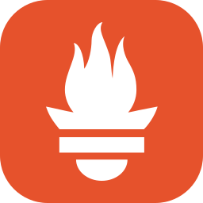
  
  
  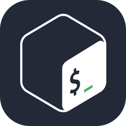
  

AWS: EC2 · EKS · S3 · RDS · Lambda · IAM · CloudWatch · Systems Manager · Backup

**Open to Cloud Operations · SRE · DevOps · Platform Engineering · Consulting**

[rafael-gross.com](https://rafael-gross.com) · [LinkedIn](https://www.linkedin.com/in/erafael-gross) · [rafagross15@gmail.com](mailto:rafagross15@gmail.com)

